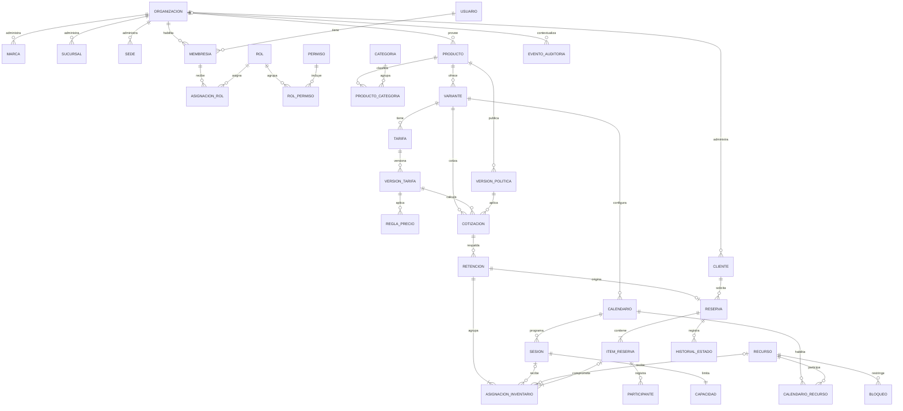

# Modelo conceptual de datos

El ámbito de las entidades privadas es la organización. Las relaciones de marca, sucursal y sede son provisionales hasta D01.

Cada asignación apunta a una sesión o a un recurso. La sesión exige cantidad positiva. El recurso exige inicio anterior al fin y una unidad. El vínculo del ítem corresponde a las asignaciones que consume; la retención conserva su vínculo histórico. La estructura de cotización y retención de la API inicial admite una selección por operación.

| Área | Claves, índices e invariantes candidatos |
|---|---|
| Ámbito | PK opaca `id`. Unicidad de `(organization_id, id)` donde se referencia una entidad privada. FK compuesta en sus referencias internas. Usuario y permisos de plataforma usan ámbito global. |
| Acceso | Membresía única por organización y usuario. Asignación única por membresía, rol y alcance. Las referencias de sede y recurso deben pertenecer a la organización. |
| Inventario | Una fila de capacidad por sesión. Índices de sesión por organización, calendario e inicio. Índice de retenciones activas por organización y expiración. Exclusión de ocupaciones activas coincidentes por recurso y rango. Los bloqueos usan la misma comprobación de ocupación y la misma serialización que las reservas. |
| Precio | Clave única por tarifa y versión, y por política y versión. Cotización con moneda y vigencia. Importe decimal exacto. Al confirmar se preservan versiones, importe, moneda y condiciones aplicadas por ítem. |
| Reserva | Retención de origen única en reserva directa. Índice por organización, estado y fecha. Historial ordenado por fecha e identificador. Referencias históricas protegidas contra borrado en cascada. |
| Idempotencia y auditoría | Clave única por organización, actor, operación y clave de solicitud. Auditoría indexada por organización, fecha e identificador y correlacionada por `correlation_id`. |

Catálogo con referencias históricas pasa a archivado. Reservas, historial y auditoría se conservan según las políticas de retención aprobadas. La anonimización de clientes y participantes respetará dichas referencias. Las transacciones financieras conservan el registro y se ajustan mediante movimientos trazables. D06 define plazos y jurisdicciones.

## Extensiones del modelo

- **Venta y cobro.** Pedido, pago, aplicación de pago y reembolso. La aplicación vincula pagos con las obligaciones admitidas cuando se aprueben las reglas financieras.
- **Acceso.** Boleto vinculado a un derecho de reserva y validación vinculada al boleto. El estado operativo se mantiene por separado.
- **Distribución.** Convenio entre proveedor y distribuidor. Publicación comercial sobre catálogo del proveedor. Comisión vinculada a la venta atribuida. Liquidación agrupa movimientos conforme a D07 y D08.
- **Integraciones.** Integración con ámbito de plataforma u organización. Evento y entrega de webhook con identificador, intentos y resultado para deduplicar y auditar.

## Tablas implementadas en Fase 2

La configuración de sesiones con cupo vive en `inventory_sessions`. Cada registro incluye la capacidad de la sesión. Los calendarios de recurso se representan mediante `resource_windows` y `resource_blocks`. Las tarifas base viven en `base_rate_versions` y las políticas en `product_policy_versions`. Las relaciones privadas usan claves foráneas compuestas de organización e identificador.

Consulta las [reglas de catálogo e inventario](catalog-inventory.md).

## Tablas implementadas en Fase 3

La cotización conserva la selección y referencias a las versiones de tarifa y política. Una retención referencia una cotización y una sesión o un recurso del mismo ámbito. La reserva referencia un cliente y una retención del mismo ámbito. Cada ítem conserva selección, importe, moneda y términos históricos. El historial registra cada transición con su correlación y actor, que puede ser el sistema.

Las claves únicas impiden reutilizar una cotización para otra retención o una retención para otra reserva. PostgreSQL excluye los intervalos activos o comprometidos que se solapan en un recurso. Los resultados de mutaciones idempotentes se identifican por organización, actor, operación y clave. Consulta [reservas directas y vencimientos](reservations-phase-three.md).

## Tablas implementadas en Fase 5

`agreements` vincula las organizaciones proveedora y agencia. `distribution_offers` vincula el convenio con una variante y una versión de tarifa del proveedor. Una cotización distribuida conserva la referencia a la oferta.

`agency_sales` relaciona la reserva operativa y la ficha privada de agencia mediante claves de ámbito separadas. Conserva el porcentaje pactado. `commission_entries` vincula cada devengo con su abono y cada reversión con su reembolso. Las claves únicas impiden repetir un tipo de movimiento para el mismo abono.

Consulta [la distribución autorizada y su demostración](distribution-phase-five.md).

## Tablas implementadas en Fase 6

`ticket_batches` vincula los boletos a la reserva confirmada y conserva la cantidad y el secreto cifrado. `ticket_checkins` impide repetir el uso mediante una clave única por lote y número. `checkin_validators` vincula el permiso con una membresía de la organización.

Los movimientos de comisión se vinculan a `settlements` mediante `settlement_items`. Las claves compuestas mantienen proveedor, agencia y moneda del corte. El pago simulado conserva su referencia. En `webhook_events`, la organización y el identificador de evento son únicos y la huella del contenido detecta reintentos incompatibles.

Consulta las [reglas y la demostración de operación](operations-phase-six.md).
