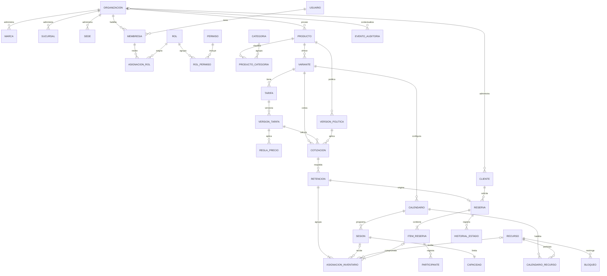

# Modelo conceptual de datos

El ámbito de las entidades privadas es la organización. Las relaciones de marca, sucursal y sede son provisionales hasta D01.

Cada asignación apunta a una sesión o a un recurso. La sesión exige cantidad positiva. El recurso exige inicio anterior al fin y una unidad. El vínculo del ítem corresponde a las asignaciones que consume; la retención conserva su vínculo histórico. La estructura de cotización y retención de la API inicial admite una selección por operación.

| Área | Claves, índices e invariantes candidatos |
|---|---|
| Ámbito | PK opaca `id`. Unicidad de `(organization_id, id)` donde se referencia una entidad privada. FK compuesta en sus referencias internas. Usuario y permisos de plataforma usan ámbito global. |
| Acceso | Membresía única por organización y usuario. Asignación única por membresía, rol y alcance. Las referencias de sede y recurso deben pertenecer a la organización. |
| Inventario | Una fila de capacidad por sesión. Índices de sesión por organización, calendario e inicio. Índice de retenciones activas por organización y expiración. Exclusión de ocupaciones activas coincidentes por recurso y rango. Los bloqueos usan la misma comprobación de ocupación y la misma serialización que las reservas. |
| Precio | Clave única por tarifa y versión, y por política y versión. Cotización con moneda y vigencia. Importe decimal exacto. Al confirmar se preservan versiones, importe, moneda y condiciones aplicadas por ítem. |
| Reserva | Retención de origen única en reserva directa. Índice por organización, estado y fecha. Historial ordenado por fecha e identificador. Referencias históricas protegidas contra borrado en cascada. |
| Idempotencia y auditoría | Clave única por organización, actor, operación y clave de solicitud. Auditoría indexada por organización, fecha e identificador y correlacionada por `correlation_id`. |

Catálogo con referencias históricas pasa a archivado. Reservas, historial y auditoría se conservan según las políticas de retención aprobadas. La anonimización de clientes y participantes respetará dichas referencias. Las transacciones financieras conservan el registro y se ajustan mediante movimientos trazables. D06 define plazos y jurisdicciones.

## Extensiones del modelo

- **Venta y cobro.** Pedido, pago, aplicación de pago y reembolso. La aplicación vincula pagos con las obligaciones admitidas cuando se aprueben las reglas financieras.
- **Acceso.** Boleto vinculado a un derecho de reserva y validación vinculada al boleto. El estado operativo se mantiene por separado.
- **Distribución.** Convenio entre proveedor y distribuidor. Publicación comercial sobre catálogo del proveedor. Comisión vinculada a la venta atribuida. Liquidación agrupa movimientos conforme a D07 y D08.
- **Integraciones.** Integración con ámbito de plataforma u organización. Evento y entrega de webhook con identificador, intentos y resultado para deduplicar y auditar.
